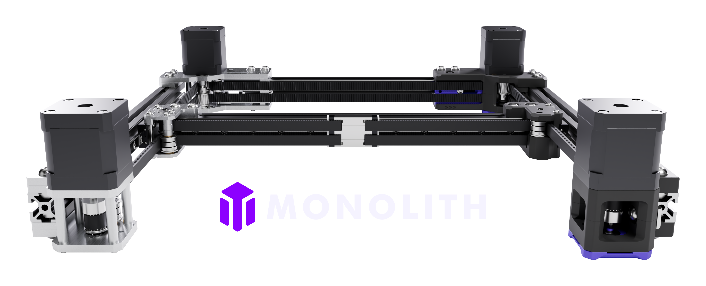

# Monolith Gantry
> [!IMPORTANT]
> **Step-by-step build guides for the printed and sheet metal versions are not yet available.**
> 
> **The sheet metal version is more difficult to build than what the average user is used to. Please evaluate the required patience and skill levels before proceeding.**

## What's this?
This is a performance-oriented, configurable gantry platform.

### [Official LDO Milled Gantry Kits](https://github.com/Monolith3D/LDO_Monolith_Gantry_Kits)

## Start Here

<a href="https://build.monolith3d.xyz/#gantry">
  <picture>
    <source media="(prefers-color-scheme: dark)" srcset="https://raw.githubusercontent.com/Monolith3D/MISC/main/Common_repo_files/monolith-builder-dark.png">
    <source media="(prefers-color-scheme: light)" srcset="https://raw.githubusercontent.com/Monolith3D/MISC/main/Common_repo_files/monolith-builder-light.png">
    
  </picture>
</a>

- [Build guides and assembly notes](Docs/)
- [Toolheads for Monolith](https://github.com/Monolith3D/Toolheads_for_Monolith) for compatible toolheads, belt clamps, and design guidelines.
- [FAQ](FAQ.md) for configuration, sourcing, and assembly questions.

### Drive configurations:
- 2WD
- AWD

### Belt widths:
- 6mm
- 9/10mm

 ### Materials:
- Printed
- Sheet metal
- LDO milled kits

## What's new
- Round bearing seats in the printed XY joints, motorless mounts, rear mounts and double-shear housings
- Simpler printed rear mounts, with counterbored stepper screws and one fewer double-shear housing screw
- VT NP spacers replace the indexing ribs on the printed VT mounts
- Sheet metal V2 mount plates take the standard 40 x 9 mm belt clamp instead of the hybrid Z-belt clips
- Updated printed Z joint NP spacer
 

> [!NOTE]
> **If you have questions or want to stay more up-to-date with Monolith, consider joining the dedicated Discord server.**
>
> 
>
> **If you would like to see more of this and other projects in the future, consider supporting Monolith on Patreon.**
>
> 

## Design goals
- The shortest and the simplest belt path possible with AWD compatibility
- The shortest moment arms possible for increased rigidity even when reusing hardware and motion parts
- Double shear steppers and live shaft idlers for higher belt tensions and better reliability
- Good-looking design
- Cheap BOM

## Performance expectations
**2WD:** Due to the 10-15cm shorter belt path, with stiffer and lighter XY-joints the printer should perform similarly to a 50mm smaller one equipped with the same X-axis setup.

**AWD:** It doesn't come at the cost of adding 20cm belt length and idlers, so input shaper scaling can be close to +100% compared to 2WD due to the truly halved effective belt length. But only when no toolhead or frame bottlenecks are limiting its scaling.

**9/10mm belts:** Wider belts can offer an additional 50% input shaper scaling on top of what's described above.

## What's the catch?
- you have to build a well-balanced system: the increased effective belt stiffness with higher-end gantry configurations will amplify toolhead and frame rigidity issues
- Some toolheads are not yet compatible because of the different belt path, see [Toolheads for Monolith](https://github.com/Monolith3D/Toolheads_for_Monolith) for compatible ones
- Z-chain relocation or Z-umbilical is needed on V2
- Trident rear vertical extrusion brackets have to be rotated by 180 degrees or swapped to regular 2020 brackets based on the gantry configuration

[Acknowledgements](Acknowledgements.md)
